# [Electronic Warfare Equipment] A General Overview of Typical Electronic Warfare, Surveillance, and Target Detection Systems

Radar Station 80K6K1 3D Aerial Surveillance Radar
A mobile, low, medium, and high altitude aerial surveillance radar with coordinate and tracking outputs. It can operate offline or as part of a regional and national automatic control station (ACP) system. Designed for: serving as part of an air defense missile unit, sending targets to the air defense missile complex; serving as an information link for air traffic control in the air force and air defense forces.
The radar system provides: detection, tracking, and measurement of air target coordinates and ground speed under conditions of interference, natural noise, active interference, passive interference, and their combined effects. It identifies enemy identification equipment on aircraft, recognizes individual and flight information provided by friendly aircraft, and represents and sends data to users. It measures and tracks the angle and bearing of the interferer's antenna, tracks and measures the target, and broadcasts data to off-line display facilities and interacts with regional and higher-level national ACP command centers.
Main specifications:
80K6M Mobile 3D Airborne Surveillance Radar
The mobile radar 80 K6 M is designed for use in radio and air defense missile units. The radar system provides: detection of air targets, three-dimensional coordinates and Doppler velocity measurements of air targets, tracking of air targets; identification of enemy identification equipment on aircraft; calculation of the elevation and bearing angle of active interference stations; data transmission to radar workstations and integrated systems.
Main specifications:
80K6T Mobile 3D Surveillance Radar
The mobile 3D transistor transmitter airborne surveillance radar is used for detecting low, medium, and high flying targets. It is primarily used: as part of an air defense missile unit, launching targets to the air defense missile system; as an information link for air traffic control in the air force and air defense forces. The radar can be transported by C-130 "Hercules" aircraft.
Main specifications:
36D6-M2 3D Airborne Surveillance Radar
The mobile 3D airspace surveillance radar is used for low and high altitude detection and target identification under the influence of active and passive interference, and outputs coordinate and track data. The radar is designed as part of a modern automatic air defense system and provides target indication for air defense anti-missile systems.
Main specifications:
Main Functions: High probability of detecting small aerial targets, including helicopters that are stationary and moving slowly along the radar line. High resistance to disturbances. Ability to detect the azimuth of interference machines. Automated correlation of echo signals with the return signals from built-in IFF devices. Capability to represent radar information and target on narrow-band communication channels. High reliability. High maneuverability. High stability and true coherence of the transmitter. A unique Doppler system for automatic detection of moving targets  
Control Systems and Composite Data Processing and Control System (IDPCS) is a ship/land-based automation information and control system for data collection and complex data processing, used to handle multiple information sources and ensure interaction with users. IDPCS is based on modern instrumentation, advanced computer technology, and data processing methods. Mission: Data collection, storage, and comprehensive analysis of air and surface combat/tactical situation; situation assessment and prediction of weapon usage decisions and plans.  
TRIADA Optical Fire Control System  
"Triada" - Light Armored Vehicle General Fire Control System, used for surveillance, detection, and automatic tracking of ground targets (armored vehicles, personnel), controlling panoramic vision systems "Pannorama-2 P", targeting and armored troop carrier module weapon control (IFV): automatic 30mm cannon ZTM-1; automatic grenade launcher AGS-17; PKT 7.62mm machine gun; 212 anti-tank missile system; smoke screen device.  
MLME Mobile Laboratory for Measuring Devices  
For inspecting measuring instruments in operation areas. In terms of functionality, it consists of two mobile complete setups 2-4/ and 2-4/, developed on the basis of the KrAZ truck body. The laboratory is equipped with a life support system, including support for hot mode (air conditioning, heating, ventilation), maintaining the temperature inside the vehicle (20±5) °C from -300 °С to +400 °С within the range of external air temperature. All-wheel drive trucks provide reliable mobility for the laboratory on different types of roads.  
ВК07-9200010-00 Specialized Body for Vehicles
07-9200010-00 is specifically designed for personal, laboratory, workshop, field kitchens, electronic systems, medical centers, and other accommodation types, with the capability to adjustable chassis.  
Portable radar and defense system GARANT-M controls radio link suppression system  
BUREVESTNIK-1M radar unit  
Usage: Mounted on sea, rivers, and high-speed vessels, including those with dynamic suspensions, as well as on shore-based lookout towers  
ANKLAV portable jammer GPS/GLONASS  
The portable jammer "ANKLAV" is designed to interfere with navigation receivers GPS/GLONASS. It is an effective tool in countering drones and precision-guided weapons. The portable jammer "ANKLAV" is manufactured in both portable and fixed versions with directional antennas and all-directional.

## Images

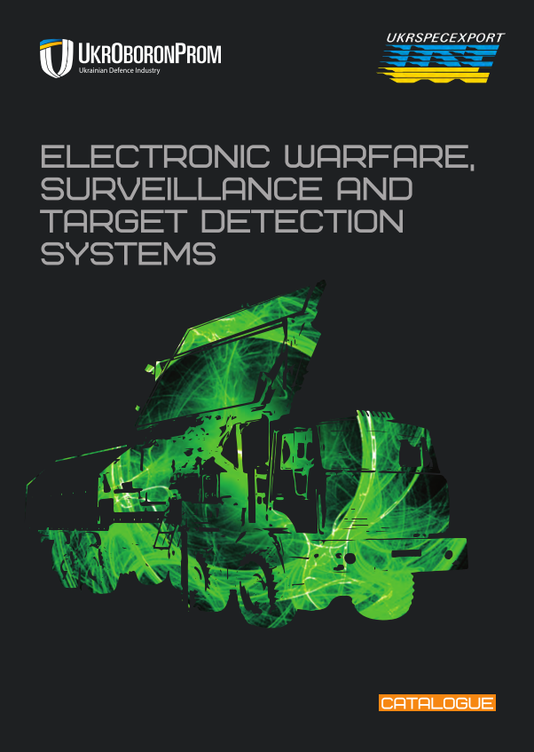
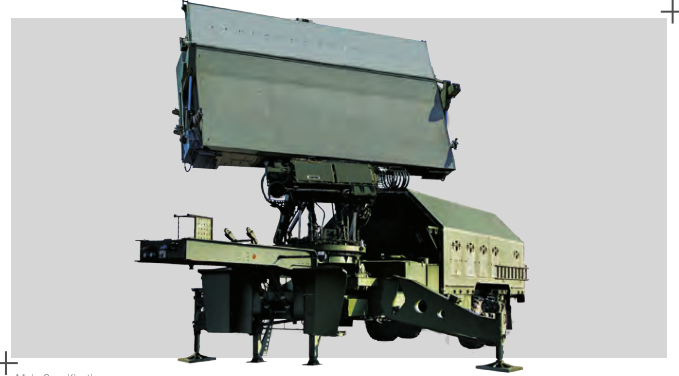
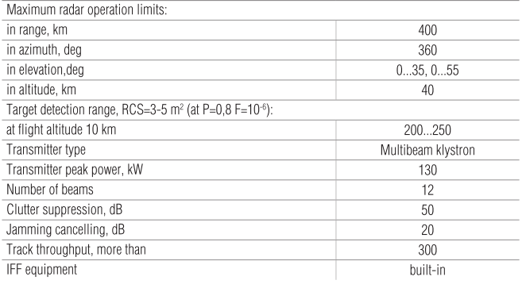
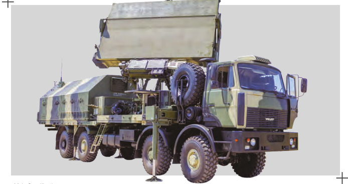
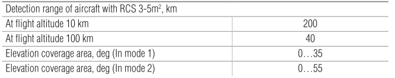
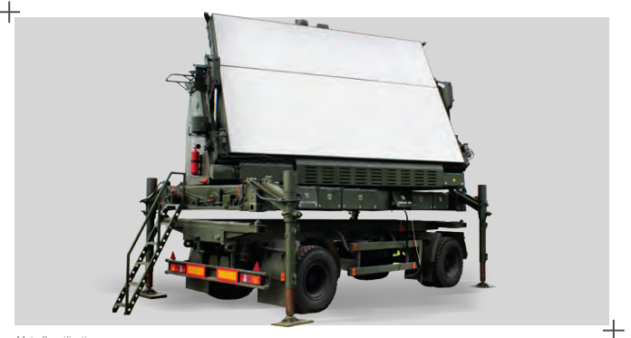
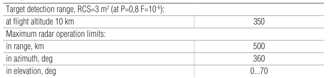
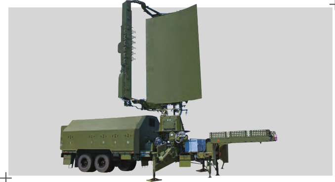
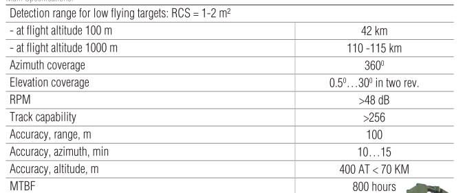
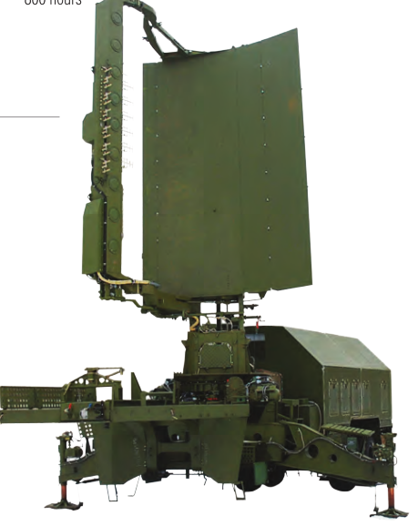
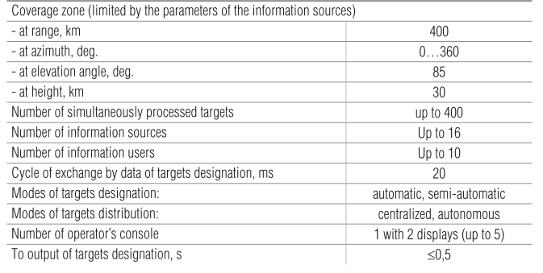
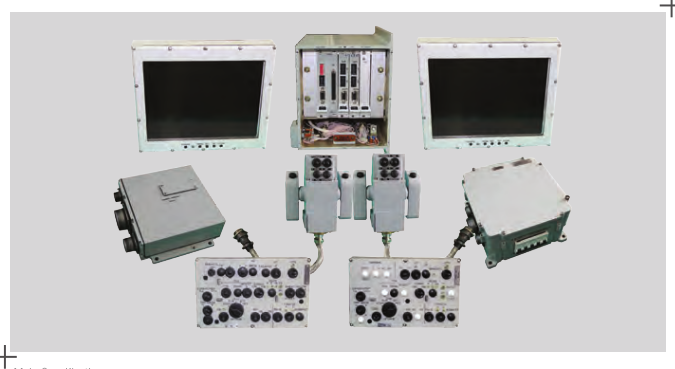
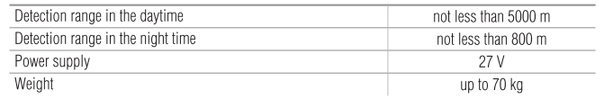
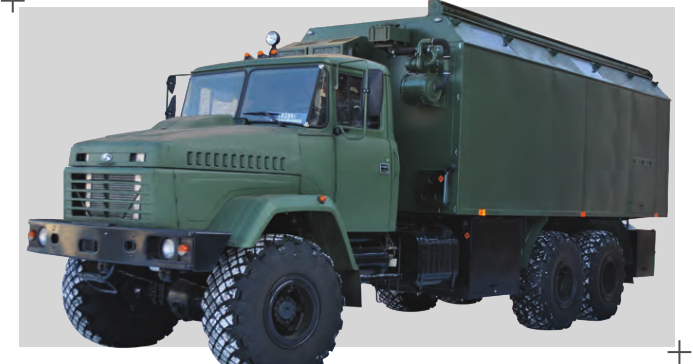
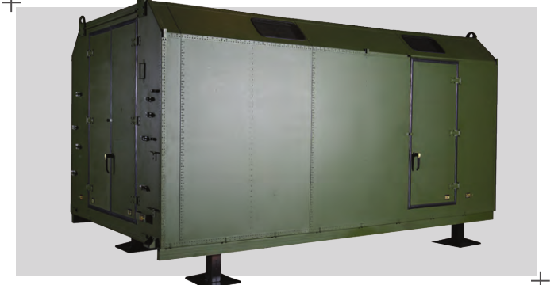

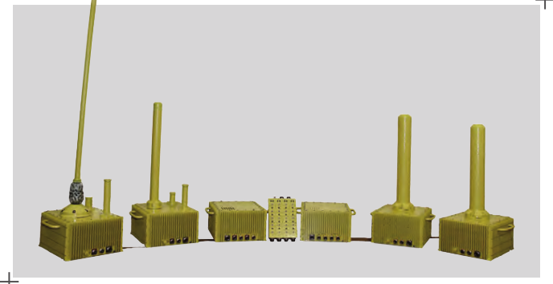
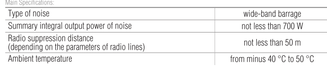
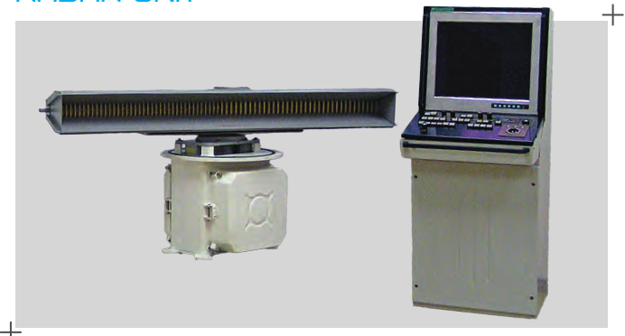
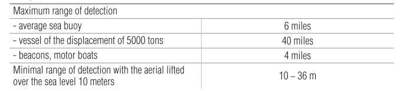
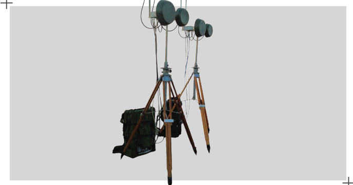
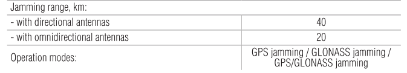

<!-- PAYMENT_BLOCK -->

## Get this dataset

- Payment link (Stripe): [Buy now](https://buy.stripe.com/3cs8yP7sY87d0vu9AB)
- Payment QR code: 

<!-- /PAYMENT_BLOCK -->
